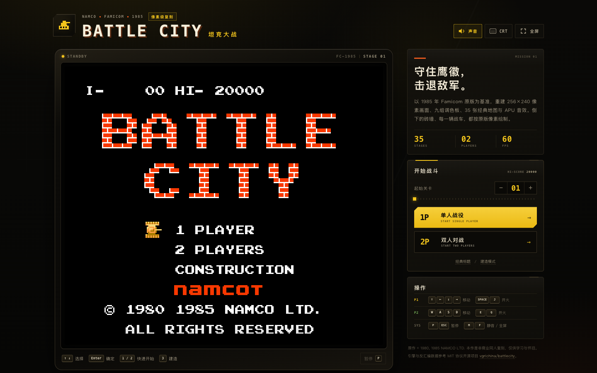
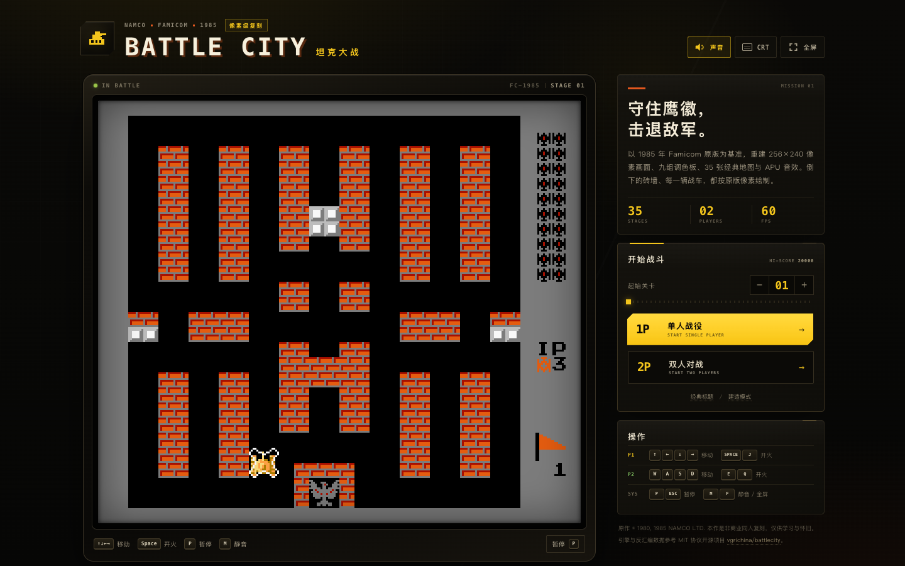

# 坦克大战 · BATTLE CITY

1985 年 Famicom《Battle City》的像素级网页复刻。无构建步骤、无外部依赖，双击 `index.html` 即可游玩。

**在线试玩：** <https://lihongcheng.github.io/battle-city/>



## 运行

**最简单：** 用 Chrome / Edge / Safari 打开 `index.html`。

**本地服务器（可选）：**

```bash
cd battle-city
python3 -m http.server 8000
# 打开 http://localhost:8000
```

游戏画面内部分辨率为 NES 原版的 **256×240**，按 3× 渲染为 768×720 的 Canvas，再以最近邻缩放显示。宽屏下画面正好 768 CSS 像素，做到 1:1 像素映射。

移动端首次点击/触摸画面会自动解锁 Web Audio。若仍无声，请确认媒体音量；iPhone 还需关闭侧边静音拨片。

## 操作

| 玩家 | 移动 | 开火 |
| --- | --- | --- |
| P1 | `↑` `←` `↓` `→` | `Space` / `J` |
| P2 | `W` `A` `S` `D` | `E` / `Q` |
| 系统 | `P` / `Esc` 暂停 · `M` 静音 · `F` 全屏 | |

在标题画面用 `↑` `↓` 选择、`Enter` 确定；也可以直接点击画布中的菜单项。按 `1` / `2` / `3` 可快速进入单人、双人或建造模式。

手机 / 平板会显示虚拟方向键、开火键和暂停键。页面上的“起始关卡”可选择 1–35 关后直接开始。

### 手机双人（同一台手机）

手机端选择 **2 PLAYERS** 后，触控区会切换为左右两套独立控制器：P1 在左、P2 在右，各有方向键和开火键，支持双人多点触控同时操作。竖屏时上下排布，横屏时位于游戏画面两侧黑边内，建议横屏游玩。

### 两台手机联机

1. 在主机手机（或电脑）点击「手机联机」。
2. 玩家 2 用另一台手机扫描二维码，或打开邀请链接 / 输入 6 位房间码。
3. 连接成功后，主机点击「开始 2P 联机对战」。

主机的屏幕显示游戏并操控 P1；另一台手机实时接收画面并操控 P2。声音由主机播放，副机画面默认静音。配对由 PeerJS 公共服务器协助，游戏数据/视频走 WebRTC 直连；建议两台设备连接同一 Wi-Fi，并使用稳定的网络环境。

## 画面



## 复刻内容

- 原版 35 张关卡地图、敌军出场顺序与四种敌军 AI 参数
- 砖墙四象限破坏、钢墙、水面、树林（遮挡坦克）、冰面滑行
- 老鹰基地、护盾、出生无敌、道具（手雷、头盔、铲子、星星、计时器）
- 32×32 的爆炸与出生动画、8×16 OAM 风格的坦克精灵
- 完整的 9 组背景调色板和 4 组精灵调色板
- 基于 NES APU 序列数据的 Web Audio 音效与关卡 BGM
- 标题画面、选关幕布、过关结算、Game Over、35 关通关演出

## 页面附加功能

- 单人 / 双人 / 建造模式入口，1–35 关快速选关
- 暂停 / 继续、静音、CRT 扫描线、全屏
- 触屏虚拟手柄；横屏时自动进入全屏游戏布局
- 最高分与上次选关会保存在浏览器 `localStorage`

## 技术说明

- `js/game.js`：游戏循环、碰撞、AI、精灵与背景渲染
- `js/levels.js`：从 Famicom ROM 解码的 35 张关卡数据
- `js/sound.js`：NES APU 声音序列 + Web Audio 合成
- `js/chr-data.js`：内嵌的 8 KB CHR 图集（Base64），保证 `file://` 直接打开也能读取像素
- `js/online.js`：主机联机大厅、房间码、二维码、PeerJS 数据/视频连接
- `remote.html` / `js/remote.js`：玩家 2 的副机控制器页面
- `tiles/chr_all.png`：同一 CHR 图集的独立文件，便于查看与替换

## 致谢与版权

游戏引擎和反汇编数据参考了 MIT 协议的开源项目 [vgrichina/battlecity](https://github.com/vgrichina/battlecity)（对 1985 年 Famicom 原版的反汇编与网页重实现）。页面外壳、触屏控制、暂停、选关、双人联机和本地化在本项目中完成。手机联机使用 [PeerJS](https://peerjs.com/)（MIT）进行配对，二维码由 [qrcode-generator](https://github.com/kazuhikoarase/qrcode-generator)（MIT）生成。

《BATTLE CITY》原作 © 1980, 1985 NAMCO LTD. 本项目为非商业同人复刻，仅用于学习与怀旧，与原权利方无关联。详见 [NOTICE.md](NOTICE.md)。
